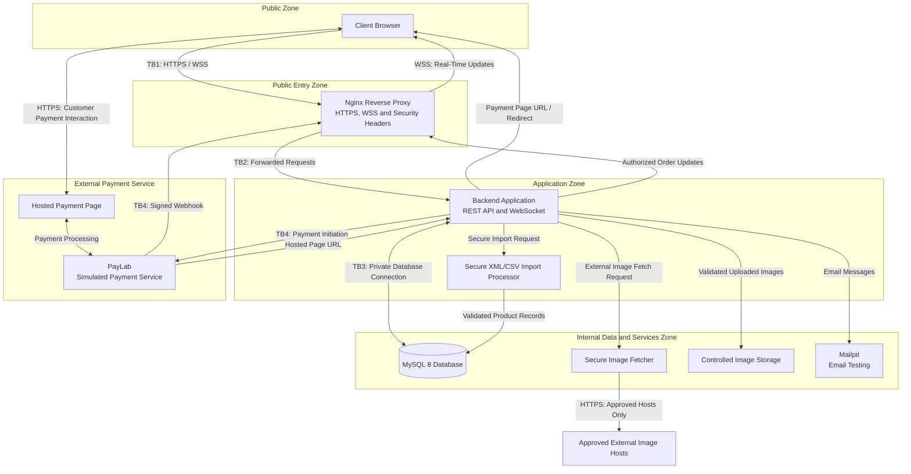
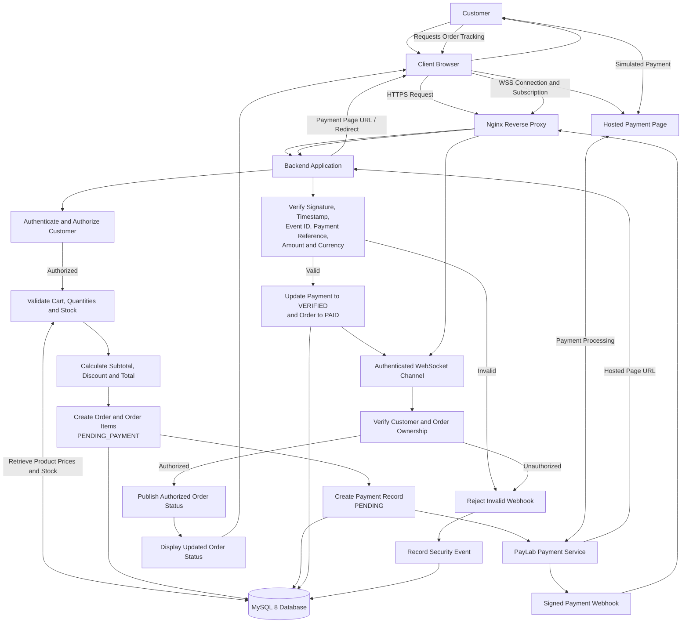
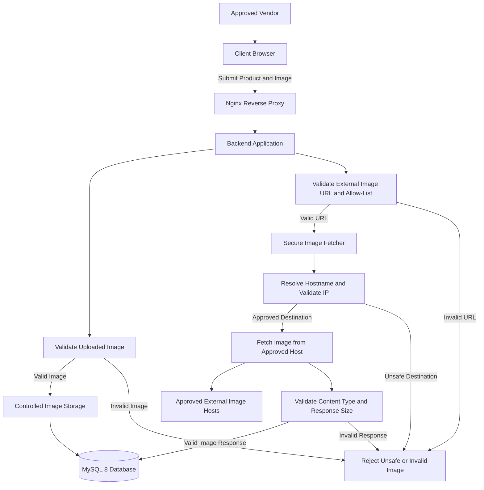
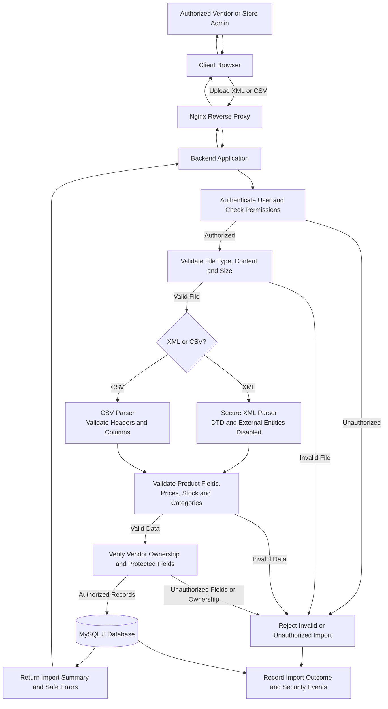

# Secure University e-Store – System Architecture and DFD

## 1. System Architecture Overview

The Secure University e-Store will use a layered architecture to separate user access, application logic, data storage, and external service integration.

The architecture will include the following main components:

- **Client Browser:** Provides the user interface for customers, vendors, Store Administrators, and Security Auditors.
- **Reverse Proxy (Nginx):** Acts as the only public entry point for the store application, handles HTTPS termination, forwards requests to the backend application, and applies security headers.
- **Backend Application (REST API and WebSocket):** Handles authentication, authorization, business logic, input validation, order processing, inventory management, real-time order notifications, and payment integration.
- **MySQL 8 Database:** Stores user accounts, vendor profiles, products, categories, shopping carts, orders, payments, reviews, coupons, audit logs, and security events.
- **PayLab Payment Service:** Simulates the payment process and sends signed payment webhooks to the backend application.
- **Internal Services:** Provide restricted internal functionality, including the secure image-fetching component.
- **Mailpit Email Testing Service:** Captures application emails in the local development and testing environment.

## 2. Architecture Components and Responsibilities

### 2.1 Client Browser

- Allows users to access the e-store through a web interface.
- Sends HTTPS requests through the reverse proxy.
- Does not connect directly to the database or internal services.
- Displays product information, shopping carts, orders, and payment results.
- Establishes an authenticated WebSocket connection to receive real-time order status updates.
- Subscribes only to order updates that the authenticated customer is authorized to access.
- Redirects customers to the external PayLab hosted payment page when payment is initiated.

### 2.2 Reverse Proxy (Nginx)

- Serves as the only public entry point to the store application.
- Terminates HTTPS connections.
- Forwards permitted REST API requests to the backend application.
- Supports secure WebSocket proxying using WSS.
- Adds security headers, including Content-Security-Policy and X-Content-Type-Options.
- Prevents direct public access to internal services and the database.
- Receives incoming PayLab webhook requests and forwards them to the backend application.
- Applies appropriate request-size and connection limits.

### 2.3 Backend Application (REST API and WebSocket)

- Provides REST API endpoints documented using OpenAPI 3.
- Provides an authenticated WebSocket channel for real-time order status updates.
- Authenticates users and enforces role-based access control.
- Validates all client input.
- Enforces business rules and calculates order totals on the server.
- Manages products, inventory, shopping carts, orders, coupons, and reviews.
- Handles product image uploads and external image URL validation.
- Requests external image fetching through the internal image-fetching component.
- Processes authorized XML and CSV catalogue imports.
- Validates imported catalogue data before storing it.
- Uses secure XML parsing with DTD and external entity processing disabled.
- Provides authenticated order retrieval and tracking operations.
- Authorizes each WebSocket order subscription by checking the authenticated customer's ownership.
- Initiates payment requests through PayLab.
- Verifies payment webhooks before updating payment and order statuses.
- Records administrative actions, import outcomes, and security events.

### 2.4 MySQL 8 Database

- Stores application data in relational tables.
- Enforces primary keys, foreign keys, unique constraints, and appropriate data validation constraints.
- Stores password hashes instead of plaintext passwords.
- Stores product image metadata and validated external image URLs.
- Stores product information imported through authorized catalogue imports.
- Does not store payment card numbers or CVV values.
- Is accessible only through authorized backend application connections.

### 2.5 PayLab Payment Service

- Simulates an external payment provider.
- Receives payment initiation requests from the backend application.
- Provides a simulated hosted payment page.
- Allows customers to complete simulated payment transactions through the hosted page.
- Sends signed webhook notifications to the backend application through the reverse proxy.
- Uses HMAC-SHA256 signatures to protect webhook integrity.
- Does not directly modify the store database.
- Does not rely on browser redirects as proof of successful payment.

### 2.6 Internal Services

- Host restricted internal application components.
- Include the secure image-fetching component.
- The image-fetching component retrieves images only from approved external hosts.
- Validates image URLs and responses before they are accepted for use by the application.
- Does not allow access to localhost, private IP ranges, link-local addresses, or other internal services.
- Internal services must not be directly accessible from the public internet.

### 2.7 Mailpit Email Testing Service

- Captures application-generated emails during development and testing.
- Supports testing of registration, password reset, and notification emails.
- Is restricted to the local development environment and must not be publicly exposed.

## 3. Network Architecture and Trust Boundaries

The system will be divided into separate network zones to reduce unauthorized access and limit the impact of security incidents.

### 3.1 Public Zone

Contains:

- Client Browsers.
- Public-facing HTTPS and WSS access to the Reverse Proxy.
- Customer browser navigation to the external PayLab hosted payment page when required.

Security rules:

- All external communication with the store application must use HTTPS or WSS.
- The browser must not access the backend application, database, or internal services directly.
- Communication with the external PayLab hosted page must use HTTPS.
- WebSocket connections must be authenticated and authorized by the backend.

### 3.2 Application Zone

Contains:

- Backend Application (REST API and WebSocket).
- Reverse Proxy connection to the backend.

Security rules:

- The backend application accepts application traffic only through the reverse proxy.
- Authentication and authorization are enforced by the backend.
- Administrative and vendor operations require appropriate role permissions.
- WebSocket subscriptions must verify customer authentication and order ownership.
- Product image requests must be validated before being sent to the internal image-fetching component.
- XML and CSV imports must pass authorization and server-side validation before database operations.

### 3.3 Internal Data and Services Zone

Contains:

- MySQL 8 Database.
- Internal Services.
- Mailpit Email Testing Service.

Security rules:

- The database must not be publicly accessible.
- Only authorized backend services may connect to the database.
- Internal services must not be directly accessible from the public zone.
- Mailpit must remain restricted to the local development environment.
- The image-fetching component must have restricted outbound access to approved external image hosts only.
- Catalogue import processing must use the backend's authorized database connection.

### 3.4 External Payment Service

Contains:

- PayLab Payment Service.
- Simulated hosted payment page.

Security rules:

- Payment initiation requests must originate from the backend application.
- The customer accesses the hosted payment page through browser navigation or redirection.
- PayLab webhooks must be authenticated using HMAC-SHA256.
- The backend must validate webhook signatures, timestamps, event identifiers, payment references, and amounts.
- Browser redirects must not be treated as proof of successful payment.

## 4. Data Flow Diagram (DFD)

### 4.1 Main Purchase and Payment Flow

The main purchase and payment process follows these steps:

1. The customer accesses the e-store through the browser using HTTPS.
2. The browser sends requests to the Reverse Proxy.
3. The Reverse Proxy forwards permitted requests to the Backend Application.
4. The Backend Application authenticates the customer and checks authorization.
5. The Backend Application retrieves product information and prices from MySQL 8.
6. The customer adds products to the shopping cart.
7. The Backend Application validates product availability, quantities, and prices.
8. The Backend Application calculates the subtotal, discount, and final order total.
9. The Backend Application creates the order and its order items with a PENDING_PAYMENT status.
10. The Backend Application creates a payment record in MySQL 8 with a PENDING status.
11. The Backend Application sends a payment initiation request to PayLab.
12. PayLab provides a hosted payment page URL for the customer.
13. The Backend Application returns the payment page URL to the browser, which navigates to the PayLab hosted payment page.
14. The customer completes the simulated payment through the PayLab hosted page.
15. PayLab sends a signed webhook notification to the Backend Application through the Reverse Proxy.
16. The Backend Application verifies the webhook signature, timestamp, event identifier, payment reference, amount, and currency.
17. If verification succeeds, the Backend Application updates the payment status to VERIFIED and the order status to PAID.
18. The Backend Application commits the successful state change and records relevant payment and security events.
19. The Backend Application publishes an order status update through the authenticated WebSocket channel.
20. The customer receives the authorized order status update through the browser.
21. The browser displays the updated order status.
22. The customer can continue receiving authorized status updates while the order is being processed.

An invalid webhook must not update the payment or order status. A browser redirect alone must never be treated as proof of payment.

### 4.2 Real-Time Order Status Flow

The order tracking process uses WebSocket communication instead of periodic REST polling.

The process follows these steps:

1. The customer opens the order tracking page.
2. The browser establishes a secure WSS connection through the Reverse Proxy.
3. The Reverse Proxy forwards the WebSocket upgrade request to the Backend Application.
4. The Backend Application authenticates the session associated with the connection.
5. The customer requests subscription to a specific order's status updates.
6. The Backend Application checks that the order exists and belongs to the authenticated customer.
7. If authorization succeeds, the backend registers the connection for that order's updates.
8. When an authorized server-side operation changes the order status, the backend commits the change to MySQL 8.
9. After the successful database commit, the backend publishes the updated status to authorized subscribers.
10. The browser receives the WebSocket message and displays the new order status.
11. Unauthorized subscriptions are rejected without revealing another customer's order information.
12. The connection is closed or invalidated when the user logs out, the session expires, or the connection is no longer valid.

WebSocket messages must contain only the information required for order tracking. The backend must not trust client-submitted order status values.

### 4.3 Product Image Handling Flow

Product images may be uploaded as image files or provided through external HTTPS URLs.

**A. Uploaded Image Flow**

1. An authorized vendor selects an image file for one of their products.
2. The browser submits the product information and image file to the Backend Application through the Reverse Proxy.
3. The Backend Application verifies vendor authorization and product ownership.
4. The Backend Application validates the file extension, actual file type, image content, and file size.
5. The application generates a safe server-side filename.
6. The image is stored in a controlled location that does not allow file execution.
7. The Backend Application stores the associated image reference with the product information in MySQL 8.
8. Invalid or unsafe files are rejected.

**B. External Image URL Flow**

1. An approved vendor enters an external HTTPS image URL for one of their products.
2. The browser sends the product information and image URL to the Backend Application through the Reverse Proxy.
3. The Backend Application validates the submitted URL format and applies the configured host allow-list.
4. The Backend Application requests image validation and retrieval through the internal Secure Image Fetcher.
5. The Secure Image Fetcher resolves the hostname and validates the destination IP address.
6. The component rejects localhost, private, link-local, and unauthorized destinations.
7. The component prevents unauthorized redirects and enforces connection timeouts and response-size limits.
8. The component validates the returned content type and accepts only supported image formats.
9. The Backend Application stores the validated external image URL with the product information in MySQL 8.
10. The product image can be displayed to customers.

The image-fetching component must not be able to access internal services or networks.

### 4.4 XML and CSV Product Catalogue Import Flow

Authorized vendors and administrators may import product catalogue data using XML or CSV files according to their permissions.

The process follows these steps:

1. An authorized vendor or administrator selects an XML or CSV catalogue file.
2. The browser submits the file through an authenticated request to the Reverse Proxy.
3. The Reverse Proxy forwards the request to the Backend Application.
4. The Backend Application authenticates the user and checks the required role and vendor ownership permissions.
5. The Backend Application validates the file size, extension, actual content, and supported format.
6. The import processor parses the file using the appropriate secure parser.
7. For XML files, DTD processing and external entity resolution are disabled to prevent XXE attacks.
8. For CSV files, the processor validates the expected headers, column structure, encoding, and field values.
9. The Backend Application validates required product fields, data types, prices, stock quantities, and category references.
10. The application rejects invalid records and prevents modification of protected fields such as vendor ownership and approval status.
11. Valid records are stored using safe database operations and transaction handling.
12. The application records the import result and relevant security events.
13. The authorized user receives an import summary containing the result and safe validation errors.

Import processing must enforce file-size, parsing-time, and resource limits. Malformed or unauthorized imports must not result in inconsistent database records.

### 4.5 Payment Security Rules

- Payment confirmation must be based on a valid PayLab webhook.
- The backend must verify the HMAC-SHA256 signature using a securely stored secret.
- Webhook timestamps must be within the allowed five-minute window.
- Duplicate and replayed webhook events must be rejected.
- The payment amount and currency must match the corresponding order.
- The webhook event must be associated with the correct payment and order.
- Invalid webhook requests must not update payment or order statuses.
- Browser redirects must never be trusted as payment confirmation.

### 4.6 WebSocket Security Rules

- WebSocket connections must use WSS.
- The backend must authenticate each connection.
- The backend must validate the connection origin.
- Customers may subscribe only to their own order updates.
- Every subscription request must undergo server-side authorization.
- Unauthorized subscriptions must be rejected.
- Sensitive payment or account information must not be sent through order status messages.
- Connections must be invalidated when sessions expire or users log out.
- Order notifications must be published only after successful server-side state changes.

### 4.7 Catalogue Import Security Rules

- Only authorized vendors or administrators may import catalogue files.
- Only XML and CSV formats are accepted.
- File size and parsing resource limits must be enforced.
- XML DTD and external entity processing must be disabled.
- Imported records must pass server-side validation.
- Vendor ownership and protected product fields must not be controlled by imported client data.
- Invalid records must be rejected safely.
- Import results and security-relevant failures must be recorded.

## 5. Trust Boundaries

The system will enforce at least four trust boundaries.

### TB1 – Public Browser to Reverse Proxy

**Description:**

Separates untrusted external users and browsers from the public-facing application entry point.

**Potential threats:**

- Cross-Site Scripting (XSS).
- Cross-Site Request Forgery (CSRF).
- Clickjacking.
- Malicious or manipulated HTTP requests.
- Unauthorized WebSocket connection attempts.

**Security controls:**

- HTTPS and WSS.
- Secure session cookies.
- Input validation and output encoding.
- CSRF protection.
- Content-Security-Policy.
- X-Frame-Options or frame-ancestors policy.
- WebSocket origin validation.

### TB2 – Reverse Proxy to Backend Application

**Description:**

Separates public-facing request handling from trusted server-side application processing.

**Potential threats:**

- Unauthorized API access.
- Authentication bypass.
- Broken access control.
- HTTP header manipulation.
- Injection attacks.
- Unauthorized order information retrieval.
- Unauthorized WebSocket subscriptions.
- Malicious catalogue import requests.

**Security controls:**

- Backend authentication and authorization.
- Server-side input validation.
- Role-based access control.
- Secure proxy configuration.
- API request validation.
- Rate limiting.
- Order ownership verification.
- WebSocket connection and subscription authorization.
- Import file validation and resource limits.

### TB3 – Backend Application to Database and Internal Services

**Description:**

Separates application processing from internal data storage and restricted services.

**Potential threats:**

- SQL Injection.
- Unauthorized database access.
- Server-Side Request Forgery (SSRF).
- XML External Entity (XXE) attacks.
- Data exposure.
- Privilege escalation.
- Malicious or malformed catalogue data.

**Security controls:**

- Parameterized SQL queries.
- Least-privilege database accounts.
- Internal network isolation.
- Restricted service access.
- Secure image-fetching allow-list.
- Blocking private and internal IP ranges.
- URL and response validation.
- Secure XML parser configuration with DTD and external entities disabled.
- XML and CSV schema and field validation.
- Safe database transactions and import processing.

### TB4 – Backend Application to PayLab

**Description:**

Separates the store backend from the external simulated payment service.

**Potential threats:**

- Forged payment callbacks.
- Webhook replay attacks.
- Payment amount tampering.
- Unauthorized payment status changes.

**Security controls:**

- HMAC-SHA256 webhook signatures.
- Timestamp validation.
- Unique webhook event identifiers.
- Payment reference and amount verification.
- Server-side payment status transitions.

## 6. Deployment and Network Isolation

- The application components will run using Docker Compose.
- The Reverse Proxy will be the only publicly exposed store application entry point.
- The backend application will communicate with MySQL 8 through a private Docker network.
- Internal services and Mailpit will not be publicly exposed.
- The image-fetching component will have restricted outbound network access to approved external image hosts.
- Catalogue import processing will be performed by the authorized backend application.
- PayLab will communicate with the backend through controlled payment initiation and webhook requests.
- The customer browser will access the PayLab hosted payment page through HTTPS.
- WebSocket traffic will be proxied securely through WSS.
- The database will use persistent storage and restricted credentials.
- The intentionally vulnerable LAB environment will be isolated from the secure environment.
- The LAB environment will be restricted to local testing and must not be exposed to the public internet.

## 7. Security Design Principles

The architecture will follow these security principles:

- Defense in Depth.
- Least Privilege.
- Separation of Duties.
- Secure Communication.
- Server-Side Validation.
- Role-Based Access Control.
- Network Segmentation.
- Secure Payment Verification.
- Secure WebSocket Communication.
- Secure File and Catalogue Import Processing.
- Audit Logging and Monitoring.
- Isolation of Vulnerable Testing Environments.

## 8. System Architecture Diagram

The following diagram illustrates the main system components, network zones, communication paths, and trust boundaries.

## 9. Data Flow Diagram – Purchase and Payment

The following diagram illustrates the main customer purchase and payment process, including real-time WebSocket order status updates.

## 10. Data Flow Diagram – Product Image Handling

The following diagram illustrates both supported product image handling methods: uploaded image files and external image URLs.

## 11. Data Flow Diagram – XML and CSV Catalogue Import

The following diagram illustrates secure catalogue import processing and the validation controls applied before product records are stored.

## 12. Summary

The proposed architecture separates public access, application processing, internal data storage, and external payment integration through defined network zones and trust boundaries.

The design includes:

- A secure REST API and authenticated WebSocket communication.
- Real-time order status updates with server-side ownership verification.
- Secure payment processing through signed PayLab webhooks.
- Product image upload and external image URL handling.
- Secure XML and CSV catalogue import with protection against XXE and malicious input.
- A restricted internal image-fetching component to reduce SSRF risks.
- MySQL 8 database isolation and least-privilege access.
- A separate intentionally vulnerable LAB environment for authorized security testing.

These architectural controls provide the foundation for implementing and testing the Secure University e-Store in later project milestones.