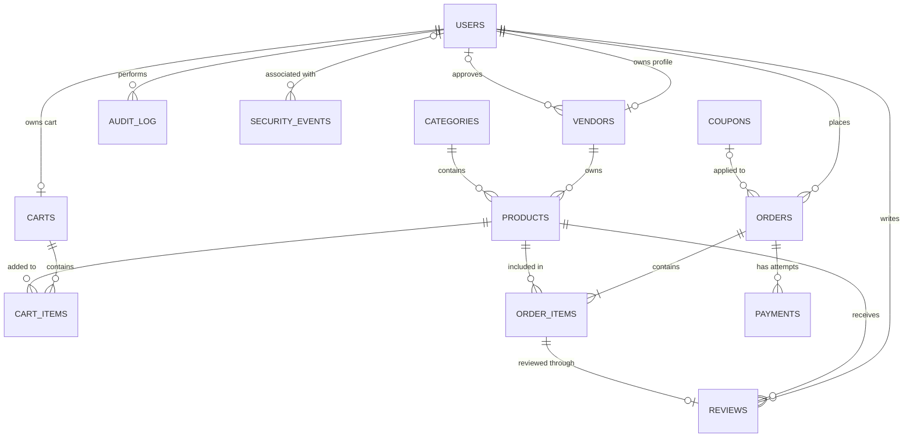

# Secure University e-Store – Database ERD

## 1. Database Design Overview

**Database Management System:** MySQL 8.0.16 or later.

The Secure University e-Store will use a relational database to store and manage application data.

The database design will support:
- Customer and vendor accounts.
- Role-based access control.
- Product catalogue and inventory.
- Shopping carts and orders.
- Order items and payment records.
- Product reviews.
- Coupons and discount management.
- Administrative audit logs.
- Security event records.

## 2. Database Design Principles

The database will follow these principles:
- Every main entity will have a primary key (PK).
- Foreign keys (FK) will maintain relationships between entities.
- Unique constraints will prevent duplicate values where required.
- NOT NULL constraints will protect required fields.
- CHECK constraints will enforce valid data ranges and values.
- Sensitive data will be classified and protected.
- Passwords will be stored as secure hashes, never as plaintext.
- Payment card numbers and CVV values will not be stored.
- Order totals and payment status will be controlled and verified by the server.
- Database transactions will protect important operations from inconsistent concurrent updates.
- Historical transaction records must be preserved.

## 2.1 Data Classification

Database information shall be classified according to its confidentiality level:

- **Public:** Information that may be displayed to all visitors, such as product names, descriptions, prices, categories, store information, and public reviews.
- **Internal:** Operational information intended for authorized system users and staff, such as product inventory, account roles, order statuses, and system configuration data.
- **Sensitive:** Personal, financial, authentication, and security-related information that requires restricted access and appropriate protection, such as names, email addresses, password hashes, shipping addresses, payment amounts, MFA secrets, and IP addresses.

Access to Internal and Sensitive data must be restricted according to user roles and authorization rules.

## 3. Database Tables

### 3.1 USERS

**Purpose:** Stores account information for all system users.

| Field | Data Type | Constraints | Classification |
|---|---|---|---|
| user_id | BIGINT | PK, AUTO_INCREMENT | Internal |
| full_name | VARCHAR(150) | NOT NULL | Sensitive |
| email | VARCHAR(255) | NOT NULL, UNIQUE | Sensitive |
| password_hash | VARCHAR(255) | NOT NULL | Sensitive |
| role | VARCHAR(30) | NOT NULL, CHECK | Internal |
| is_active | BOOLEAN | NOT NULL, DEFAULT TRUE | Internal |
| mfa_enabled | BOOLEAN | NOT NULL, DEFAULT FALSE | Internal |
| mfa_secret_encrypted | VARCHAR(255) | NULL | Sensitive |
| created_at | TIMESTAMP | NOT NULL | Internal |
| updated_at | TIMESTAMP | NOT NULL | Internal |

**Role Values:**
- CUSTOMER
- VENDOR
- STORE_ADMIN
- SECURITY_AUDITOR

**Security Constraints:**
- Email addresses must be unique.
- Passwords must be stored as bcrypt or Argon2 hashes.
- MFA secrets must be encrypted when stored.
- User roles must be validated and controlled by the server.
- Users must not be allowed to modify their own roles.
- Only authorized users may access personal account information.

### 3.2 VENDORS

**Purpose:** Stores vendor-specific information and approval status.

| Field | Data Type | Constraints | Classification |
|---|---|---|---|
| vendor_id | BIGINT | PK, AUTO_INCREMENT | Internal |
| user_id | BIGINT | FK, NOT NULL, UNIQUE | Internal |
| store_name | VARCHAR(150) | NOT NULL | Public |
| store_description | TEXT | NULL | Public |
| approval_status | VARCHAR(20) | NOT NULL, CHECK | Internal |
| approved_by | BIGINT | FK, NULL | Internal |
| approved_at | TIMESTAMP | NULL | Internal |
| created_at | TIMESTAMP | NOT NULL | Internal |

**Approval Status Values:**
- PENDING
- APPROVED
- REJECTED
- SUSPENDED

**Relationships:**
- Each vendor account belongs to one user in USERS.
- A user can have at most one vendor profile.
- The approved_by field references the administrator who approved the vendor.

**Security Constraints:**
- Only Store Administrators can approve or reject vendors.
- Vendors cannot change their own approval status.
- Only approved vendors can publish products.
- The application must verify that approved_by references an authorized Store Administrator.

### 3.3 PRODUCTS

**Purpose:** Stores product information, pricing, and inventory.

| Field | Data Type | Constraints | Classification |
|---|---|---|---|
| product_id | BIGINT | PK, AUTO_INCREMENT | Internal |
| vendor_id | BIGINT | FK, NOT NULL | Internal |
| product_name | VARCHAR(200) | NOT NULL | Public |
| description | TEXT | NULL | Public |
| price | DECIMAL(10,2) | NOT NULL, CHECK (price > 0) | Public |
| stock_quantity | INT | NOT NULL, CHECK (stock_quantity >= 0) | Internal |
| category_id | BIGINT | FK, NOT NULL | Internal |
| image_url | VARCHAR(2048) | NULL | Public |
| product_status | VARCHAR(20) | NOT NULL, CHECK | Internal |
| created_at | TIMESTAMP | NOT NULL | Internal |
| updated_at | TIMESTAMP | NOT NULL | Internal |

**Product Status Values:**
- DRAFT
- PUBLISHED
- UNPUBLISHED
- SUSPENDED

**Relationships:**
- Each product belongs to one vendor in VENDORS.
- Each product belongs to one category in CATEGORIES.
- A vendor can own multiple products.

**Security Constraints:**
- Only approved vendors can publish products.
- Vendors can modify only their own products.
- Product prices must be greater than zero.
- Stock quantities cannot be negative.
- Image URLs must be processed through the secure image-fetching component.
- External image URLs must use HTTPS and approved hosts.
- The image-fetching component must validate resolved IP addresses, redirects, response size, content type, and time limits to prevent SSRF.
- Product prices must never be trusted from client-submitted checkout data.

### 3.4 CATEGORIES

**Purpose:** Organizes products into categories.

| Field | Data Type | Constraints | Classification |
|---|---|---|---|
| category_id | BIGINT | PK, AUTO_INCREMENT | Internal |
| category_name | VARCHAR(100) | NOT NULL, UNIQUE | Public |
| description | TEXT | NULL | Public |
| is_active | BOOLEAN | NOT NULL, DEFAULT TRUE | Internal |
| created_at | TIMESTAMP | NOT NULL | Internal |

**Relationships:**
- Each category can contain multiple products.
- Each product belongs to one category through PRODUCTS.category_id.

**Security Constraints:**
- Only Store Administrators can create, update, or deactivate categories.
- Inactive categories must not be available for new product listings.
- Existing product records must retain their category references.

### 3.5 CARTS

**Purpose:** Stores the shopping cart associated with each customer.

| Field | Data Type | Constraints | Classification |
|---|---|---|---|
| cart_id | BIGINT | PK, AUTO_INCREMENT | Internal |
| customer_id | BIGINT | FK, NOT NULL, UNIQUE | Sensitive |
| created_at | TIMESTAMP | NOT NULL | Internal |
| updated_at | TIMESTAMP | NOT NULL | Internal |

**Security Constraints:**
- Each customer can have at most one shopping cart.
- Each cart must belong to exactly one customer.
- Customers can access and modify only their own carts.
- Cart contents and prices must be validated by the server during checkout.
- The server must retrieve current product prices from the database and must not trust client-submitted prices.

### 3.6 CART_ITEMS

**Purpose:** Stores the products and quantities included in each customer's shopping cart.

| Field | Data Type | Constraints | Classification |
|---|---|---|---|
| cart_item_id | BIGINT | PK, AUTO_INCREMENT | Internal |
| cart_id | BIGINT | FK, NOT NULL | Internal |
| product_id | BIGINT | FK, NOT NULL | Internal |
| quantity | INT | NOT NULL, CHECK (quantity > 0) | Internal |
| added_at | TIMESTAMP | NOT NULL | Internal |

**Additional Constraint:**

UNIQUE (cart_id, product_id)

**Security Constraints:**
- Each cart item must belong to an existing cart and product.
- A product must appear only once in the same cart.
- Customers can add, update, or remove items only from their own carts.
- The quantity must be greater than zero and must not exceed available stock.
- Product prices must be retrieved from the database during checkout.
- Clients must not be allowed to submit or modify product prices.
- Stock availability must be checked again during checkout using database transactions to prevent overselling.

### 3.7 ORDERS

**Purpose:** Stores customer orders, their status, financial totals, and the shipping address snapshot used for each order.

| Field | Data Type | Constraints | Classification |
|---|---|---|---|
| order_id | BIGINT | PK, AUTO_INCREMENT | Internal |
| customer_id | BIGINT | FK, NOT NULL | Sensitive |
| coupon_id | BIGINT | FK, NULL | Internal |
| order_status | VARCHAR(30) | NOT NULL, CHECK | Internal |
| subtotal | DECIMAL(10,2) | NOT NULL, CHECK (subtotal >= 0) | Sensitive |
| discount_amount | DECIMAL(10,2) | NOT NULL, DEFAULT 0, CHECK (discount_amount >= 0) | Sensitive |
| total_amount | DECIMAL(10,2) | NOT NULL, CHECK (total_amount >= 0) | Sensitive |
| shipping_address_snapshot | JSON | NOT NULL | Sensitive |
| created_at | TIMESTAMP | NOT NULL | Internal |
| updated_at | TIMESTAMP | NOT NULL | Internal |

**Order Status Values:**
- CREATED
- PENDING_PAYMENT
- PAID
- SHIPPED
- DELIVERED
- CANCELLED
- REFUNDED

**Relationships:**
- Each order belongs to one customer in USERS.
- A customer can create multiple orders.
- Each order can contain multiple order items through ORDER_ITEMS.
- An order may use zero or one coupon.

**Security Constraints:**
- Order totals and discounts must be calculated and validated on the server.
- Customers can view only their own orders.
- Order status transitions must follow the defined state machine.
- Customers and vendors cannot directly modify order status.
- An order can become PAID only after successful payment verification.
- The shipping_address_snapshot field must store a validated JSON object.
- The JSON object must contain recipient_name, phone, address_line, city, and country.
- The application must validate the presence and data types of all required JSON fields before storing the snapshot.
- The snapshot must preserve the shipping address as it existed when the order was placed.
- The stored snapshot must not be changed when a customer updates their address information elsewhere.
- The database must enforce that discount_amount does not exceed subtotal.
- The database must enforce that total_amount equals subtotal minus discount_amount.

### 3.8 ORDER_ITEMS

**Purpose:** Stores the products included in each order and preserves their purchase-time prices.

| Field | Data Type | Constraints | Classification |
|---|---|---|---|
| order_item_id | BIGINT | PK, AUTO_INCREMENT | Internal |
| order_id | BIGINT | FK, NOT NULL | Internal |
| product_id | BIGINT | FK, NOT NULL | Internal |
| quantity | INT | NOT NULL, CHECK (quantity > 0) | Internal |
| unit_price | DECIMAL(10,2) | NOT NULL, CHECK (unit_price > 0) | Sensitive |
| line_total | DECIMAL(10,2) | NOT NULL, CHECK (line_total >= 0) | Sensitive |

**Additional Constraint:**

UNIQUE (order_item_id, product_id)

**Relationships:**
- Each order item belongs to one order in ORDERS.
- Each order item references one product in PRODUCTS.
- An order can contain multiple order items.
- A product can appear in multiple order items.

**Security Constraints:**
- Quantity must be greater than zero.
- Unit price must be retrieved and validated by the server.
- The unit_price field preserves the product price at the time of purchase.
- line_total must equal quantity multiplied by unit_price.
- The database must enforce the line_total calculation using a CHECK constraint.
- Clients must not be allowed to modify unit_price or line_total.

### 3.9 PAYMENTS

**Purpose:** Stores simulated payment transactions and their verification information.

| Field | Data Type | Constraints | Classification |
|---|---|---|---|
| payment_id | BIGINT | PK, AUTO_INCREMENT | Internal |
| order_id | BIGINT | FK, NOT NULL | Sensitive |
| payment_reference | VARCHAR(100) | NOT NULL, UNIQUE | Internal |
| webhook_event_id | VARCHAR(100) | UNIQUE, NULL | Internal |
| payment_status | VARCHAR(20) | NOT NULL, CHECK | Internal |
| amount | DECIMAL(10,2) | NOT NULL, CHECK (amount > 0) | Sensitive |
| currency | CHAR(3) | NOT NULL | Internal |
| provider | VARCHAR(50) | NOT NULL | Internal |
| paid_at | TIMESTAMP | NULL | Internal |
| created_at | TIMESTAMP | NOT NULL | Internal |

**Payment Status Values:**
- PENDING
- VERIFIED
- FAILED
- REFUNDED

**Relationships:**
- Each payment belongs to one order in ORDERS.
- An order may have multiple payment attempts.
- Each payment has a unique payment reference.

**Security Constraints:**
- The application must verify that the webhook event is associated with the correct payment and order before updating the payment status.
- Payment confirmation must come from a verified PayLab webhook.
- Webhook signatures must be verified using HMAC-SHA256.
- Webhook timestamps must be within the allowed five-minute window.
- Duplicate and replayed webhook events must be rejected.
- Payment amounts must match the corresponding server-calculated order totals.
- The application must prevent more than one VERIFIED payment from being accepted for the same order.
- The application must enforce this rule safely within a database transaction.
- webhook_event_id must be unique when present.
- Payment card numbers and CVV values must never be stored.
- Browser redirects must never be treated as proof of successful payment.
- A refund must be for the full verified payment amount. Partial refunds are not supported by this database design.
- A refunded payment must have the REFUNDED status, and its associated order must be updated to REFUNDED after the refund is successfully processed.

### 3.10 REVIEWS

**Purpose:** Stores customer reviews and ratings for purchased products.

| Field | Data Type | Constraints | Classification |
|---|---|---|---|
| review_id | BIGINT | PK, AUTO_INCREMENT | Internal |
| customer_id | BIGINT | FK, NOT NULL | Sensitive |
| product_id | BIGINT | FK, NOT NULL | Internal |
| order_item_id | BIGINT | FK, NOT NULL | Internal |
| rating | INT | NOT NULL, CHECK (rating BETWEEN 1 AND 5) | Public |
| review_text | TEXT | NULL | Public |
| created_at | TIMESTAMP | NOT NULL | Internal |
| updated_at | TIMESTAMP | NOT NULL | Internal |

**Additional Constraint:**

FOREIGN KEY (order_item_id, product_id)  
REFERENCES ORDER_ITEMS (order_item_id, product_id)

UNIQUE (order_item_id)

**Relationships:**
- Each review belongs to one customer in USERS.
- Each review refers to one product in PRODUCTS.
- Each review is linked to one purchased item in ORDER_ITEMS.
- Each purchased item can have at most one review.

**Security Constraints:**
- Only customers who purchased the product can submit a review.
- A review must reference an order item belonging to the same customer and product.
- The application must verify that the customer_id of the review matches the customer_id of the order associated with the referenced order_item_id.
- Ratings must be between 1 and 5.
- Review text must be sanitized before display.
- Customers must not submit duplicate reviews for the same purchased item.

### 3.11 COUPONS

**Purpose:** Stores discount coupons and their usage restrictions.

| Field | Data Type | Constraints | Classification |
|---|---|---|---|
| coupon_id | BIGINT | PK, AUTO_INCREMENT | Internal |
| coupon_code | VARCHAR(50) | NOT NULL, UNIQUE | Public |
| discount_type | VARCHAR(20) | NOT NULL, CHECK | Internal |
| discount_value | DECIMAL(10,2) | NOT NULL, CHECK (discount_value > 0) | Internal |
| max_uses | INT | NOT NULL, CHECK (max_uses > 0) | Internal |
| used_count | INT | NOT NULL, DEFAULT 0, CHECK (used_count >= 0 AND used_count <= max_uses) | Internal |
| start_at | TIMESTAMP | NOT NULL | Internal |
| expires_at | TIMESTAMP | NOT NULL | Internal |
| is_active | BOOLEAN | NOT NULL, DEFAULT TRUE | Internal |
| created_at | TIMESTAMP | NOT NULL | Internal |

**Discount Type Values:**
- PERCENTAGE
- FIXED_AMOUNT

**Security Constraints:**
- Coupon codes must be unique.
- Coupons must be active and within their validity period to be used.
- The system must enforce the maximum usage limit.
- Coupon usage must be updated safely during concurrent checkouts using database transactions.
- Discount values must be calculated and validated on the server.
- Clients must not be allowed to modify coupon usage counts or discount amounts.
- Percentage discounts must not exceed 100%.
- The expiration timestamp must be later than the start timestamp.

### 3.12 AUDIT_LOG

**Purpose:** Maintains records of important administrative actions for accountability and auditing.

| Field | Data Type | Constraints | Classification |
|---|---|---|---|
| audit_id | BIGINT | PK, AUTO_INCREMENT | Internal |
| admin_id | BIGINT | FK, NOT NULL | Sensitive |
| action | VARCHAR(100) | NOT NULL | Internal |
| entity_type | VARCHAR(50) | NOT NULL | Internal |
| entity_id | BIGINT | NULL | Internal |
| reason | TEXT | NULL | Internal |
| ip_address | VARCHAR(45) | NULL | Sensitive |
| created_at | TIMESTAMP | NOT NULL | Internal |

**Relationships:**
- Each audit record is associated with one administrator in USERS.
- An administrator can generate multiple audit records.

**Security Constraints:**
- Audit records must be append-only.
- Administrators must not be able to modify or delete existing audit records through normal application operations.
- Important administrative actions must be recorded.
- Refund records must include a reason.
- Audit records must be accessible to authorized Security Auditors in read-only mode.
- Sensitive information such as passwords, session tokens, and payment card data must never be logged.
- The application must verify that admin_id references an authorized Store Administrator.

### 3.13 SECURITY_EVENTS

**Purpose:** Records security-related events for monitoring, investigation, and auditing.

| Field | Data Type | Constraints | Classification |
|---|---|---|---|
| event_id | BIGINT | PK, AUTO_INCREMENT | Internal |
| user_id | BIGINT | FK, NULL | Sensitive |
| event_type | VARCHAR(100) | NOT NULL | Internal |
| severity | VARCHAR(20) | NOT NULL, CHECK | Internal |
| source_ip | VARCHAR(45) | NULL | Sensitive |
| description | TEXT | NULL | Internal |
| endpoint | VARCHAR(255) | NULL | Internal |
| created_at | TIMESTAMP | NOT NULL | Internal |

**Severity Values:**
- LOW
- MEDIUM
- HIGH
- CRITICAL

**Relationships:**
- Each security event may be associated with one user in USERS.
- A user can be associated with multiple security events.
- Events without an authenticated user are allowed.

**Security Constraints:**
- Security events must be recorded for relevant security incidents.
- Security Auditors must have read-only access to security events.
- Unauthorized users must not access security event records.
- Sensitive information, passwords, session tokens, and payment card data must never be logged.
- Security event records must be protected against unauthorized modification or deletion through normal application operations.

## 4. Entity Relationships and Cardinalities

The database entities are connected through primary keys and foreign keys as follows:

| Parent Entity | Child Entity | Foreign Key | Relationship | Description |
|---|---|---|---|---|
| USERS | VENDORS | user_id | One-to-One (1:0..1) | A user may have one vendor profile. |
| USERS | VENDORS | approved_by | One-to-Many (1:N) | An administrator can approve multiple vendors. |
| USERS | ORDERS | customer_id | One-to-Many (1:N) | A customer can create multiple orders. |
| USERS | REVIEWS | customer_id | One-to-Many (1:N) | A customer can submit multiple reviews. |
| USERS | AUDIT_LOG | admin_id | One-to-Many (1:N) | An administrator can generate multiple audit records. |
| USERS | SECURITY_EVENTS | user_id | One-to-Many (1:N) | A user may be associated with multiple security events. |
| USERS | CARTS | customer_id | One-to-One (1:0..1) | A customer may have one shopping cart. |
| VENDORS | PRODUCTS | vendor_id | One-to-Many (1:N) | A vendor can own multiple products. |
| CATEGORIES | PRODUCTS | category_id | One-to-Many (1:N) | A category can contain multiple products. |
| CARTS | CART_ITEMS | cart_id | One-to-Many (1:N) | A shopping cart can contain multiple cart items. |
| PRODUCTS | CART_ITEMS | product_id | One-to-Many (1:N) | A product can appear in multiple shopping carts. |
| ORDERS | ORDER_ITEMS | order_id | One-to-Many (1:N) | An order can contain multiple items. |
| PRODUCTS | ORDER_ITEMS | product_id | One-to-Many (1:N) | A product can appear in multiple order items. |
| ORDERS | PAYMENTS | order_id | One-to-Many (1:N) | An order may have multiple payment attempts. |
| PRODUCTS | REVIEWS | product_id | One-to-Many (1:N) | A product can receive multiple reviews. |
| ORDER_ITEMS | REVIEWS | order_item_id | One-to-One (1:0..1) | A purchased item can have at most one review. |
| COUPONS | ORDERS | coupon_id | One-to-Many (1:N) | A coupon may be applied to multiple orders, while an order may use zero or one coupon. |

## 5. Referential Integrity

The database shall enforce referential integrity through foreign key constraints.

- A vendor profile must reference an existing user.
- Every product must reference an existing vendor and category.
- Every order must reference an existing customer.
- Every cart must reference an existing customer.
- Every cart item must reference an existing cart and product.
- Every order item must reference an existing order and product.
- Every payment must reference an existing order.
- Every review must reference an existing customer, product, and order item.
- Every audit record must reference an existing administrator.
- Security events may reference an existing user or remain unassociated with a user.
- The approved_by field must reference an existing user when present.
- Records must not be deleted in a way that breaks required historical records.
- Historical orders, order items, payments, reviews, audit records, and security events must be preserved.
- Foreign key deletion behavior should use RESTRICT for records that must remain available for historical or audit purposes. Deactivation or soft deletion should be used where appropriate instead of deleting historical records.

## 6. Additional Database Constraints

The database and application shall enforce the following additional constraints and security rules.

### 6.1 USERS
- The email field must contain unique values.
- The role field must accept only CUSTOMER, VENDOR, STORE_ADMIN, or SECURITY_AUDITOR.
- Password hashes must be generated using bcrypt or Argon2.
- MFA secrets must be encrypted before storage.

### 6.2 VENDORS
- Each user_id must reference a unique user.
- The approval_status field must accept only PENDING, APPROVED, REJECTED, or SUSPENDED.
- Only Store Administrators can approve vendors.

### 6.3 PRODUCTS
- The price must be greater than zero.
- The stock_quantity must be zero or greater.
- The product_status field must accept only DRAFT, PUBLISHED, UNPUBLISHED, or SUSPENDED.
- Only approved vendors may publish products.
- External product image URLs must be validated before being stored or fetched.

### 6.4 ORDERS
- The subtotal, discount_amount, and total_amount must not be negative.
- The discount_amount must not exceed the subtotal.
- The database must enforce that total_amount equals subtotal minus discount_amount.
- The application must verify that the user creating an order has the CUSTOMER role.
- The application must validate the required fields and data types in shipping_address_snapshot.
- The order status must follow the defined server-side state machine.

### 6.5 ORDER_ITEMS
- The quantity must be greater than zero.
- The unit_price must be greater than zero.
- The line_total must equal quantity multiplied by unit_price.
- The application must retrieve the purchase-time unit price from the database.

### 6.6 PAYMENTS
- The payment_reference must be unique.
- The amount must be greater than zero.
- The payment_status must accept only PENDING, VERIFIED, FAILED, or REFUNDED.
- The webhook_event_id must be unique when present.
- The application must prevent multiple VERIFIED payments for the same order.
- Payment verification must be based on a valid PayLab webhook.
- Refunds must be full refunds of the verified payment amount.

### 6.7 REVIEWS
- The rating must be between 1 and 5.
- The order_item_id must be unique to prevent multiple reviews for the same purchased item.
- The application must verify that the review's customer_id matches the customer who owns the order associated with the referenced order_item_id.
- The composite foreign key must ensure that the review references the correct product and purchased item.

### 6.8 COUPONS
- The coupon_code must be unique.
- The used_count must not exceed max_uses.
- Percentage discounts must not exceed 100%.
- The expiration timestamp must be later than the start timestamp.
- Coupon usage must be updated safely during concurrent checkouts.

### 6.9 AUDIT_LOG
- Existing audit records must not be updated or deleted through normal application operations.
- Refund actions must include a reason.
- Only authorized Store Administrators may create administrative audit records through the application.

### 6.10 SECURITY_EVENTS
- Security event records must be protected against unauthorized modification or deletion.
- User references may be NULL for events generated before authentication.
- Security Auditors have read-only access.

### 6.11 CARTS Constraints
- Each customer can have at most one shopping cart.
- Each cart must belong to exactly one customer.
- A customer can access and modify only their own cart.

### 6.12 CART_ITEMS Constraints
- Each cart item must reference an existing cart and product.
- Quantity must be greater than zero.
- The same product must appear only once in the same cart.
- The cart item quantity must not exceed the available product stock.
- The application must validate stock availability during cart updates and checkout using database transactions to prevent overselling.
- Product prices must be retrieved from the database, not trusted from client input.
- A customer must not modify cart items belonging to another customer.

### 6.13 Database CHECK Constraint Implementation Notes

The following CHECK constraints must be implemented in the MySQL database:

- USERS.role must contain an allowed role value.
- VENDORS.approval_status must contain an allowed approval value.
- PRODUCTS.price must be greater than zero.
- PRODUCTS.stock_quantity must be zero or greater.
- PRODUCTS.product_status must contain an allowed status value.
- CART_ITEMS.quantity must be greater than zero.
- ORDERS.subtotal, discount_amount, and total_amount must be non-negative.
- ORDERS.discount_amount must not exceed subtotal.
- ORDERS.total_amount must equal subtotal minus discount_amount.
- ORDER_ITEMS.quantity must be greater than zero.
- ORDER_ITEMS.unit_price must be greater than zero.
- ORDER_ITEMS.line_total must equal quantity multiplied by unit_price.
- PAYMENTS.amount must be greater than zero.
- PAYMENTS.payment_status must contain an allowed status value.
- REVIEWS.rating must be between 1 and 5.
- COUPONS.discount_value must be greater than zero.
- COUPONS.max_uses must be greater than zero.
- COUPONS.used_count must be between zero and max_uses.
- COUPONS.discount_type must contain an allowed discount type.
- SECURITY_EVENTS.severity must contain an allowed severity value.

MySQL CHECK constraints are enforced in MySQL 8.0.16 and later. Cross-table business rules, role checks, ownership verification, webhook verification, and transaction-dependent rules must also be enforced by the application and appropriate database transactions.

## 7. Entity Relationship Diagram

The following diagram illustrates the relationships between the database entities.

## 8. Conclusion

The database design provides a relational structure for the Secure University e-Store using MySQL 8.0.16 or later.

The design includes 13 main tables covering user accounts, vendors, products, categories, shopping carts, orders, payments, reviews, coupons, audit logs, and security events.

Primary keys, foreign keys, unique constraints, NOT NULL constraints, and CHECK constraints help maintain data integrity.

Sensitive information is classified and protected. Passwords are stored as secure hashes, MFA secrets are encrypted, and payment card information is not stored.

The design also supports secure payment verification through signed PayLab webhooks, server-side price and order calculations, ownership validation, stock management, and historical audit records.

The ERD serves as the database design foundation for the next implementation phases of the project.